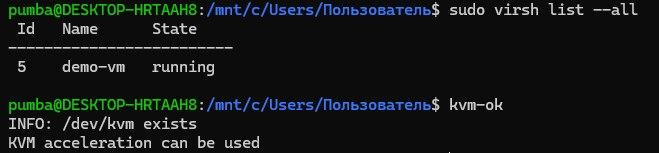
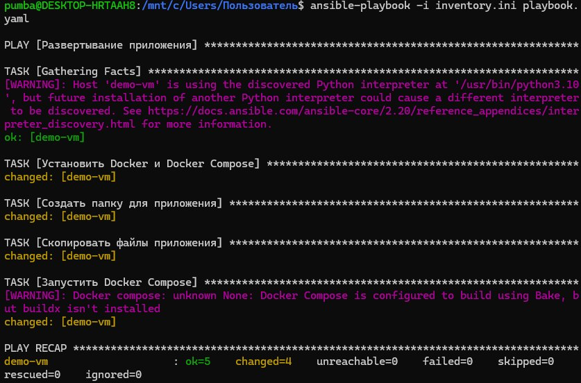
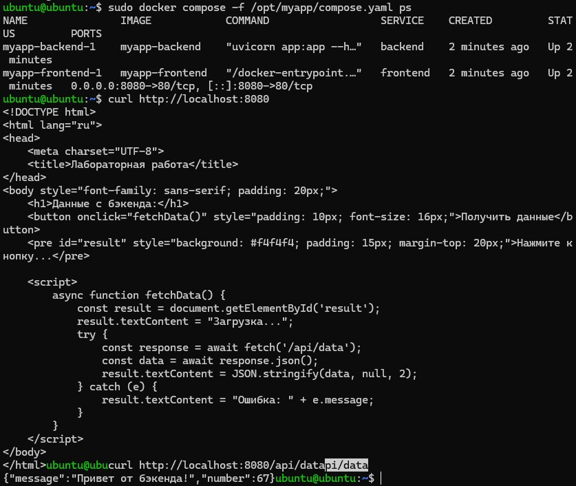
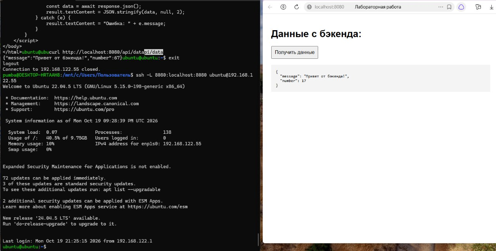
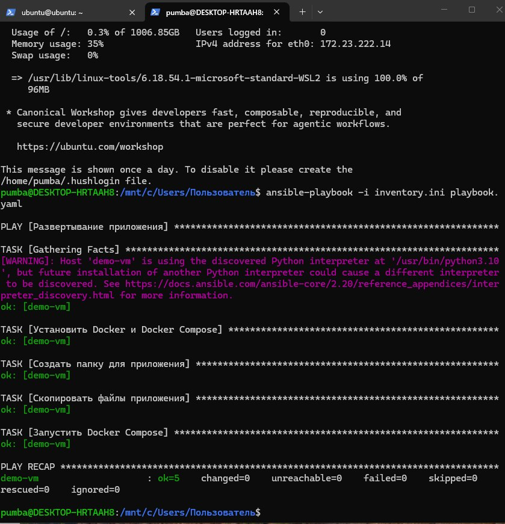
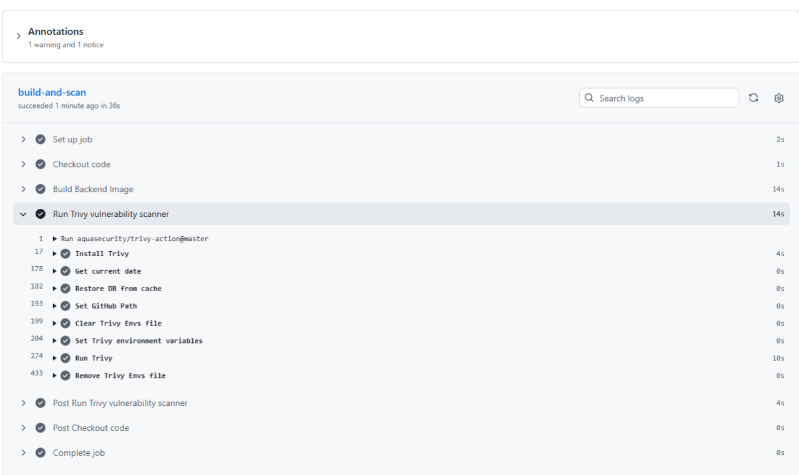

Лабораторная работа №2:

Мини-приложение, состоящее из фронтенда (Nginx + HTML/JS) и бэкенда (Python + FastAPI). 
Фронтенд запрашивает данные у бэкенда по внутренней сети Docker.

Инструкция по запуску

1. Запуск локально (Уровень 5, Windows + Docker Desktop)

1. Установить Docker Desktop
2. В корне проекта выполнить: docker compose up -d --build
3. Открыть в браузере: http://localhost:8080

2. Запуск в KVM через Ansible (Уровни 8-10)

1. В WSL (Ubuntu) создать вм:
sudo virt-install --name demo-vm --memory 2048 --vcpus 2 \
  --disk path=new-vm-disk.qcow2,format=qcow2 \
  --cdrom ubuntu-22.04.5-live-server-amd64.iso \
  --network network=default,model=virtio \
  --graphics vnc,listen=0.0.0.0

2. Подождать установку Ubuntu Server (пользователь ubuntu, пароль 1, включит OpenSSH server)
3. Внутри VM настройте беспарольный sudo:
echo "ubuntu ALL=(ALL) NOPASSWD: ALL" | sudo tee /etc/sudoers.d/ubuntu-nopasswd 
4. На хосте (WSL) запустить Ansible playbook:
ansible-playbook -i inventory.ini playbook.yaml
5. Проверить работу приложения через SSH-туннель:
ssh -L 8080:localhost:8080 ubuntu@192.168.122.55
6. Открыть http://localhost:8080

Способ проверки связи фронтенда с бэкендом
На открывшейся странице нажать кнопку «Получить данные». Если ниже появился JSON-ответ от бэкенда, значит связь работает корректно

Скриншоты
Работающий KVM в WSL (Уровень 8):

Успешный запуск Ansible (Уровень 9):

Приложение работает внутри VM (Уровень 9):

Приложение открывается в браузере на Windows (Уровень 9):

Повторный запуск Ansible — идемпотентность (Уровень 10):

Сканирование Trivy:

